# Secure Report Portal

A security-first, multi-tenant AWS serverless application for delivering HTML reports to customers. Each customer has an isolated space with a dedicated S3 bucket. Reports are served via CloudFront with signed cookies, authenticated through API Gateway + Cognito.

## What It Does

Secure Report Portal enables consultancies and service providers to securely deliver HTML-based reports (assessments, audits, reviews) to their customers through a branded, self-service web portal.

### The Problem

Delivering sensitive reports to customers typically involves emailing attachments, sharing links to shared drives, or using generic file-sharing tools. These approaches lack access control, audit trails, and professional presentation.

### The Solution

Report Portal provides a dedicated, secure channel where:

- **Admins** (the service provider) create isolated customer spaces, upload HTML reports, and invite customers
- **Customers** log in with MFA, browse their reports in a clean portal, and provide feedback directly within the platform
- **Super Admins** manage the entire platform, invite other admins, and monitor usage via analytics and audit logs

### Key Business Capabilities

| Capability | Description |
|-----------|-------------|
| **Customer Spaces** | Each customer gets an isolated space with its own S3 bucket. No cross-customer data leakage is possible. |
| **Report Delivery** | Upload HTML reports (with embedded charts, tables, Mermaid diagrams) that customers view in a sandboxed iframe. |
| **Invitation-Only Access** | No self-registration. Admins invite customers by email; invitations expire after 24 hours. |
| **MFA-Enforced Login** | Every user must set up TOTP (authenticator app) on first login. No exceptions. |
| **Feedback System** | Customers can submit feedback on reports with file attachments. Admins receive email + in-app notifications. Threaded conversations with status tracking (open/in-progress/resolved). |
| **Audit Trail** | Every action (login, report view, upload, user change) is logged with 2-year retention. |
| **Analytics** | Track report views, active users, and engagement per space. Export analytics data for reporting. |
| **Impersonation** | Super admins can impersonate customers (read-only) for support and troubleshooting. |
| **Role-Based Access** | Three roles (Super Admin, Admin, Customer) with fine-grained permissions. Admins are scoped to their assigned spaces. |

### Typical Workflow

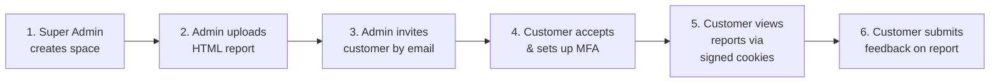

## Architecture

### System Overview

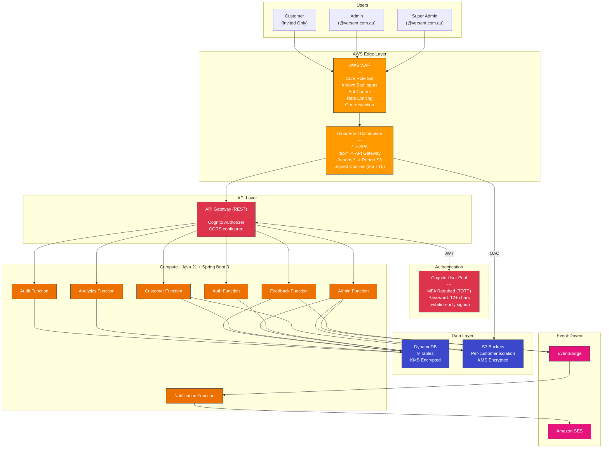

### CDK Stacks

The infrastructure is organized into 9 CDK stacks with explicit dependencies:

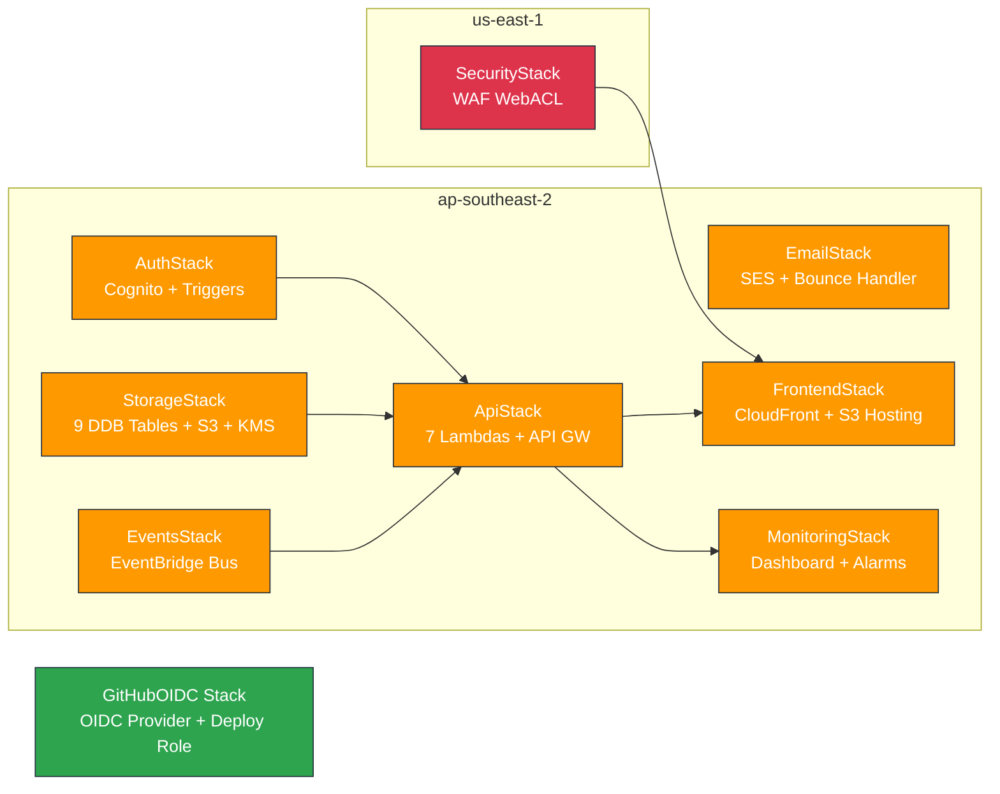

### Authentication Flow

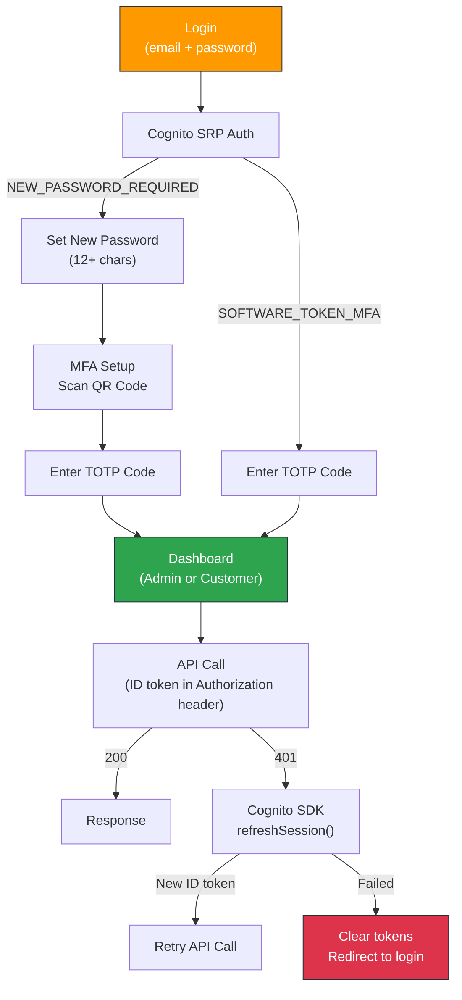

Key details:
- **ID token** (not access token) is used for API calls — it contains `custom:role` and `custom:customer_space` claims
- **Token refresh** uses Cognito SDK client-side (`refreshSession()`), not a backend endpoint
- **JwtAuthenticationFilter** in each Lambda validates the JWT signature, extracts claims, and populates `SecurityContext` via ThreadLocal
- **SecurityContext** is always cleared in a `finally` block to prevent ThreadLocal leaks

### Report Viewing Flow

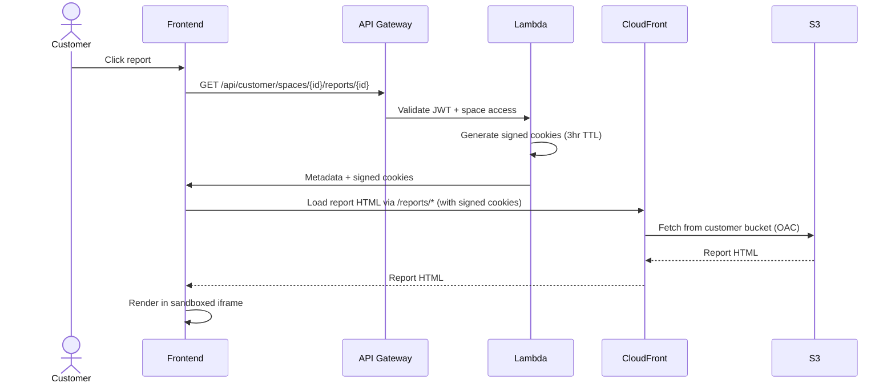

### Feedback & Notification Flow

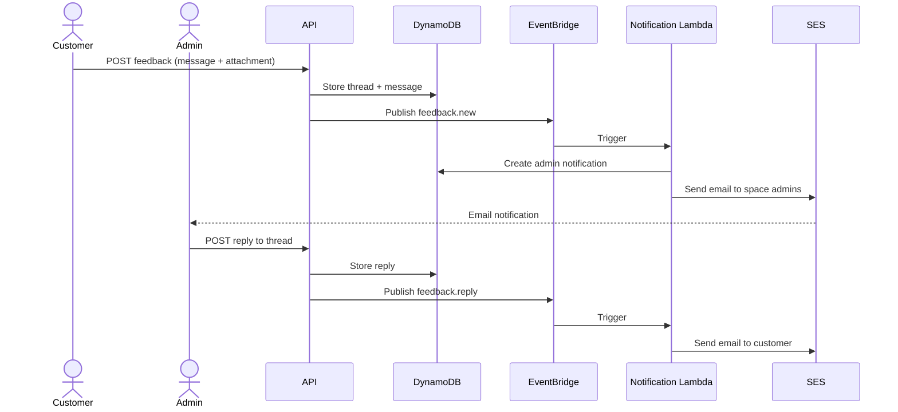

## CI/CD Pipeline

All CI/CD runs through GitHub Actions. No local deployment scripts are needed — `scripts/deploy.sh` is a thin wrapper that triggers the GitHub Actions workflow.

### Pipeline Architecture

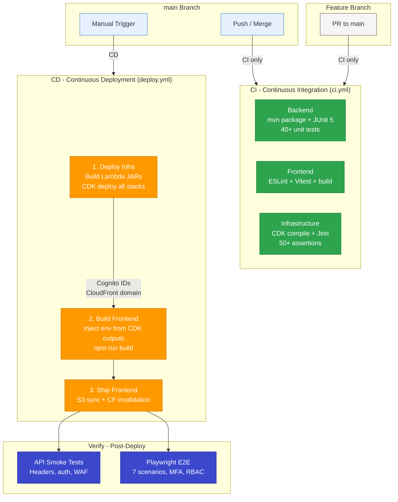

### Workflows

| Workflow | Trigger | Stage | Purpose |
|----------|---------|-------|---------|
| `ci.yml` | PR + push to `main` | **CI** | Lint, test, build — fast feedback on every change |
| `deploy.yml` | Manual (`workflow_dispatch`) | **CD** | Deploy infra → Build frontend (with real env) → Deploy to S3 |
| `api-tests.yml` | Post-deploy or manual | **Verify** | API smoke tests (no browser needed) |
| `e2e-tests.yml` | Post-deploy or manual | **Verify** | Playwright E2E tests with browser |

### Why Frontend Builds After CDK Deploy

The deploy pipeline solves a **chicken-and-egg problem**: the frontend needs Cognito and CloudFront values that only exist after CDK deploys.

```
CDK Deploy → extracts outputs → generates .env.production → frontend build uses real values
```

The `skip_infra` flag skips CDK deploy and looks up existing values from CloudFormation stacks — useful for frontend-only deploys.

### First-Time CI/CD Setup

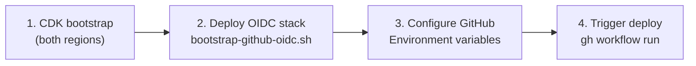

**One-time steps:**

```bash
# 1. Bootstrap CDK (required once per account per region)
cd infrastructure
cdk bootstrap aws://ACCOUNT_ID/ap-southeast-2
cdk bootstrap aws://ACCOUNT_ID/us-east-1

# 2. Deploy GitHub OIDC provider + deploy role
./scripts/bootstrap-github-oidc.sh dev

# 3. Configure GitHub (Settings -> Environments -> create "dev")
#    Variable: AWS_DEPLOY_ROLE_ARN = <role ARN from step 2>
#    Secret:   E2E_ADMIN_EMAIL = <test admin email>
#    Secret:   E2E_ADMIN_PASSWORD = <test admin password>

# 4. Trigger deployment
gh workflow run deploy.yml -f environment=dev
# Or use the convenience wrapper:
./scripts/deploy.sh dev --watch
```

The OIDC stack creates an IAM role scoped to your GitHub repo only. GitHub Actions gets temporary credentials via OIDC federation — no long-lived AWS keys are stored anywhere.

## Tech Stack

| Layer | Technology |
|-------|-----------|
| Frontend | React 18, TypeScript, Vite, Tailwind CSS, shadcn/ui |
| Backend | Java 21, Spring Boot 3, Spring Cloud Function, Lambda SnapStart |
| Infrastructure | CDK v2 (TypeScript), 9 stacks |
| Auth | Cognito User Pool (MFA enforced, TOTP) |
| Database | DynamoDB (9 tables, KMS encrypted) |
| Storage | S3 (per-customer bucket isolation, KMS) |
| CDN | CloudFront (consolidated distribution) + WAF |
| Email | Amazon SES |
| Events | Amazon EventBridge |
| CI/CD | GitHub Actions (OIDC auth, no stored keys) |

## Project Structure

```
ReportsPortal/
├── .github/workflows/
│   ├── ci.yml                    # CI: lint, test, build on PR/push
│   ├── deploy.yml                # CD: full deploy pipeline
│   ├── api-tests.yml             # API smoke tests (reusable)
│   └── e2e-tests.yml             # Playwright E2E tests (reusable)
├── scripts/
│   ├── deploy.sh                 # Wrapper for gh workflow run
│   └── bootstrap-github-oidc.sh  # One-time OIDC setup
├── infrastructure/               # CDK v2 TypeScript
│   ├── bin/                      # CDK app entry point
│   ├── lib/
│   │   ├── stacks/               # 9 stacks
│   │   └── constructs/           # Reusable constructs
│   └── test/                     # CDK assertion tests
├── backend/                      # Java 21 + Spring Boot 3
│   ├── shared/                   # Shared library (security, models)
│   ├── auth-function/            # Authentication Lambda
│   ├── admin-function/           # Admin operations Lambda
│   ├── customer-function/        # Customer operations Lambda
│   ├── feedback-function/        # Feedback system Lambda
│   ├── analytics-function/       # Analytics Lambda
│   ├── audit-function/           # Audit log Lambda
│   ├── notification-function/    # Notification delivery Lambda
│   └── cognito-triggers/         # Cognito pre-signup trigger
├── frontend/                     # React SPA
│   └── src/
│       ├── components/           # UI components
│       ├── pages/                # Route pages
│       ├── contexts/             # Auth, notification contexts
│       ├── services/             # API layer
│       └── types/                # TypeScript interfaces
├── e2e/                          # Playwright E2E tests
│   ├── tests/                    # Test specs
│   └── scripts/                  # API smoke test script
└── docker-compose.yml            # Local dev (DynamoDB Local)
```

## Security

### Authentication Pipeline

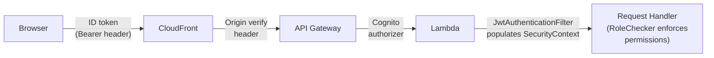

Every API request passes through:
1. **CloudFront WAF** — Rate limiting, geo-restriction, managed rules
2. **API Gateway Cognito Authorizer** — Validates JWT signature and expiry
3. **JwtAuthenticationFilter** (Spring Boot) — Extracts claims, populates ThreadLocal `SecurityContext`
4. **RoleChecker** — Enforces role-based permissions per endpoint

### MFA Enforcement

Every user must enrol TOTP-based MFA on first login. No exceptions, no SMS fallback.

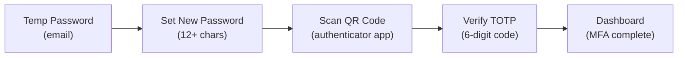

- **Mandatory TOTP** — Cognito configured with `MFA: REQUIRED`, `SOFTWARE_TOKEN_MFA` only
- **QR code** generated client-side (`qrcode.react`), no secret sent to external services
- **Admin MFA reset** — Forces user to re-enrol on next login
- **No SMS fallback** — Eliminates SIM-swap attack vectors

### Security Layers

| Layer | Protection |
|-------|-----------|
| **Network** | Dual WAF (CloudFront + API GW), rate limiting (1000/5min), geo-restriction (AU), origin verification header |
| **Identity** | Cognito MFA (TOTP), invitation-only, 15min access / 1hr refresh tokens, JWT validation in each Lambda |
| **Data** | Per-customer S3 isolation, KMS encryption (customer-managed key), CloudFront signed cookies (3hr TTL) |
| **Application** | Role-based access (3 roles), impersonation read-only mode, HTML sanitization (OWASP), iframe sandboxing |
| **Audit** | All operations logged, 2-year retention, exportable |

## Role Model

| Role | Access |
|------|--------|
| **Super Admin** | Full access, impersonation, admin invitations, space CRUD (@versent.com.au only) |
| **Admin** | Manage assigned spaces, invite customers, upload reports, user management (@versent.com.au only) |
| **Customer** | View reports in assigned spaces, submit feedback (invited only) |

## Testing

### Test Coverage

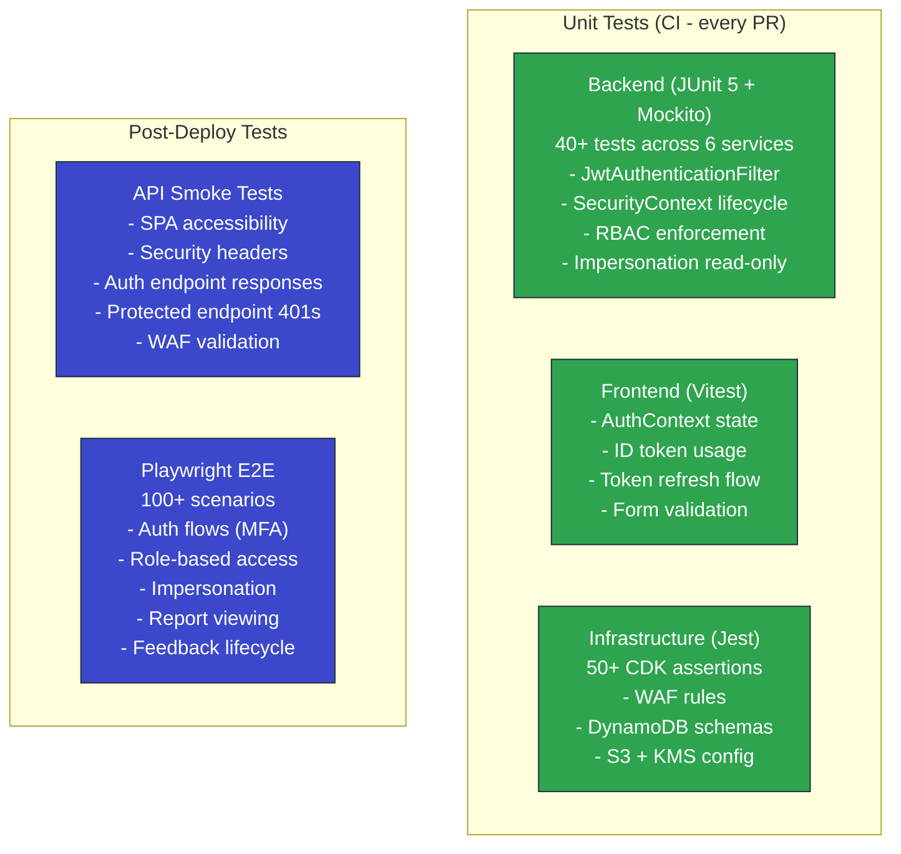

### Regression Tests for Critical Fixes

| Bug | Root Cause | Regression Test |
|-----|-----------|-----------------|
| Login redirect loop | Missing `JwtAuthenticationFilter` — `SecurityContext` never populated | `JwtAuthenticationFilterTest`: 7 tests covering filter lifecycle |
| Protected endpoints always 403 | Frontend sent access token (missing `custom:role`) instead of ID token | `AuthContext.test.tsx`: asserts `setTokens()` receives ID token |
| Token refresh 404 | Called non-existent `POST /auth/refresh` backend endpoint | `api.test.ts`: asserts refresh uses Cognito SDK `refreshSession()` |
| ThreadLocal leak | `SecurityContext.clear()` not called on exception path | `securityContextClearedEvenOnException` test |

### Running Tests

```bash
# Backend unit tests
cd backend && ./mvnw test

# Frontend unit tests
cd frontend && npm test

# CDK assertion tests
cd infrastructure && npm test

# E2E tests (requires deployed environment)
cd e2e && BASE_URL=https://your-cloudfront-domain npx playwright test

# API smoke tests (requires deployed environment)
BASE_URL=https://your-cloudfront-domain node e2e/scripts/api-smoke-test.mjs
```

## Local Development

### 1. Start Local Services

```bash
docker compose up -d    # DynamoDB Local on :8000, Admin UI on :8001
```

### 2. Build & Run Backend

```bash
cd backend
./mvnw clean package -DskipTests
sam local start-api --template template.yaml --port 3001 --warm-containers EAGER
```

### 3. Run Frontend

```bash
cd frontend
cp .env.example .env.development
npm install && npm run dev    # http://localhost:5173
```

## Environment Configuration

Environments are configured in `infrastructure/cdk.json`:

```json
{
  "dev": {
    "account": "123456789012",
    "region": "ap-southeast-2",
    "domainName": "dev.reports.yourdomain.com",
    "allowedGeoLocations": ["AU"],
    "wafRateLimit": 1000,
    "signedCookieTtlHours": 3,
    "invitationExpiryHours": 24,
    "superAdminEmail": "admin@yourdomain.com",
    "logRetentionDays": 30
  }
}
```

### Data Retention

| Resource | dev / staging | prod |
|----------|--------------|------|
| Cognito User Pool | `DESTROY` | `RETAIN` |
| DynamoDB Tables | `DESTROY` | `RETAIN` |
| S3 Buckets | `DESTROY` | `RETAIN` |

### Environment Variables

**Frontend** (`frontend/.env.example`):
```
VITE_API_BASE_URL=http://localhost:3001
VITE_COGNITO_USER_POOL_ID=ap-southeast-2_XXXXXXXXX
VITE_COGNITO_CLIENT_ID=xxxxxxxxxxxxxxxxxxxxxxxxxx
VITE_COGNITO_REGION=ap-southeast-2
VITE_CLOUDFRONT_DOMAIN=https://portal.yourdomain.com
```

**Backend** (`backend/.env.example`):
```
DYNAMODB_ENDPOINT=http://localhost:8000
COGNITO_USER_POOL_ID=ap-southeast-2_XXXXXXXXX
COGNITO_CLIENT_ID=xxxxxxxxxxxxxxxxxxxxxxxxxx
AWS_REGION=ap-southeast-2
SES_SENDER_EMAIL=noreply@reports.yourdomain.com
```

## User Journeys

### Super Admin

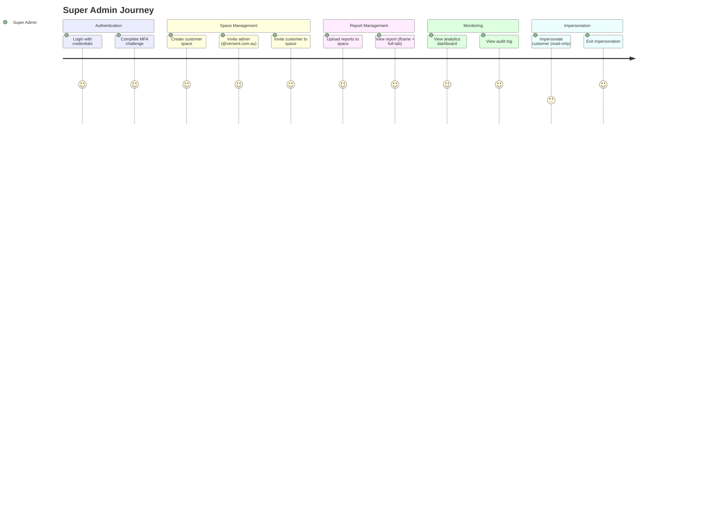

### Admin

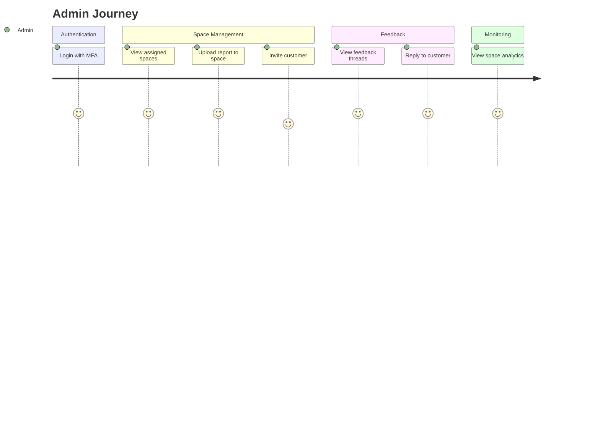

### Customer

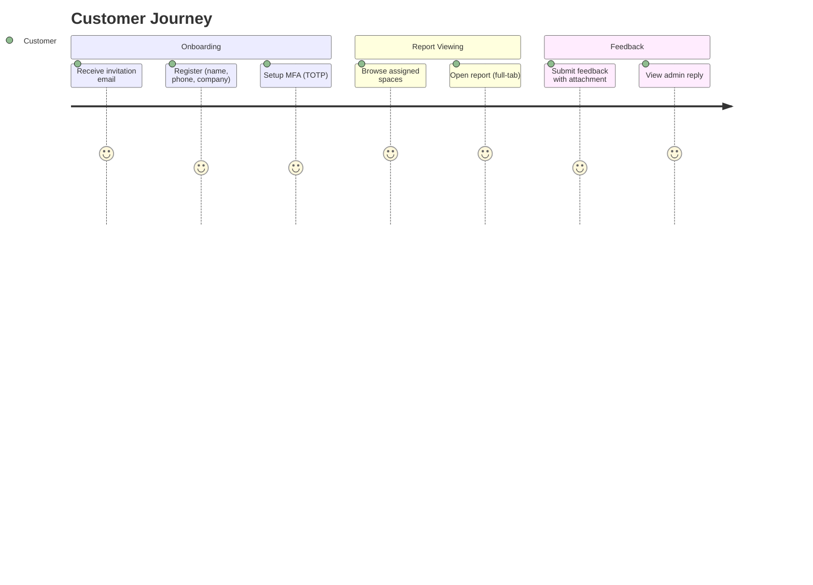

### Invitation Flow

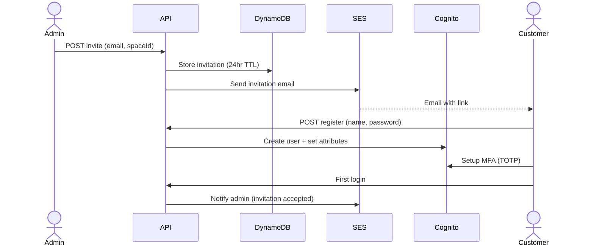
