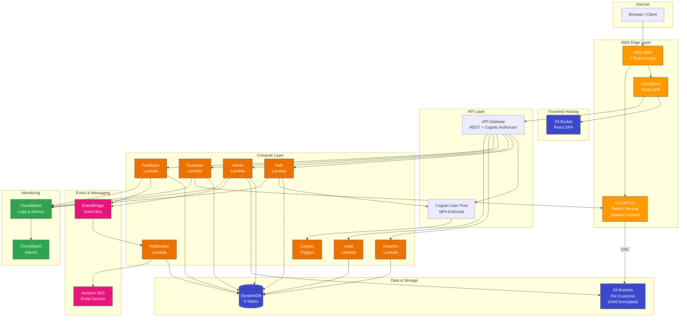
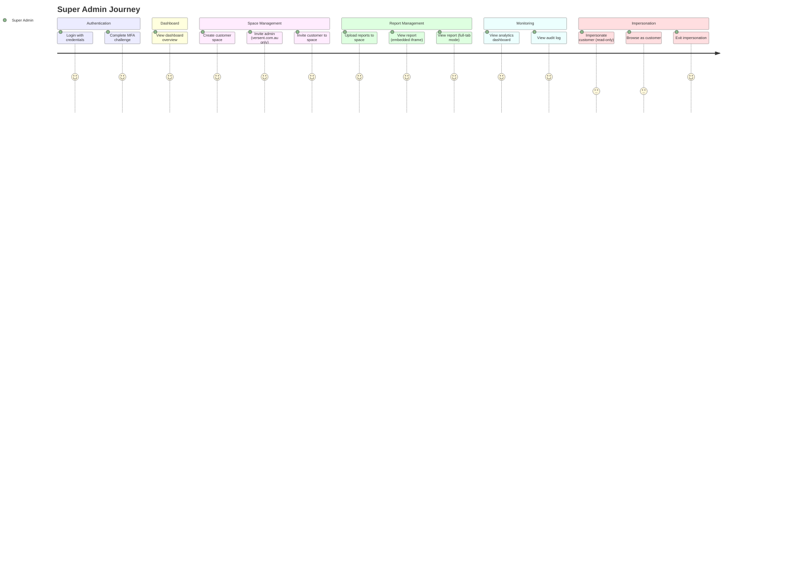
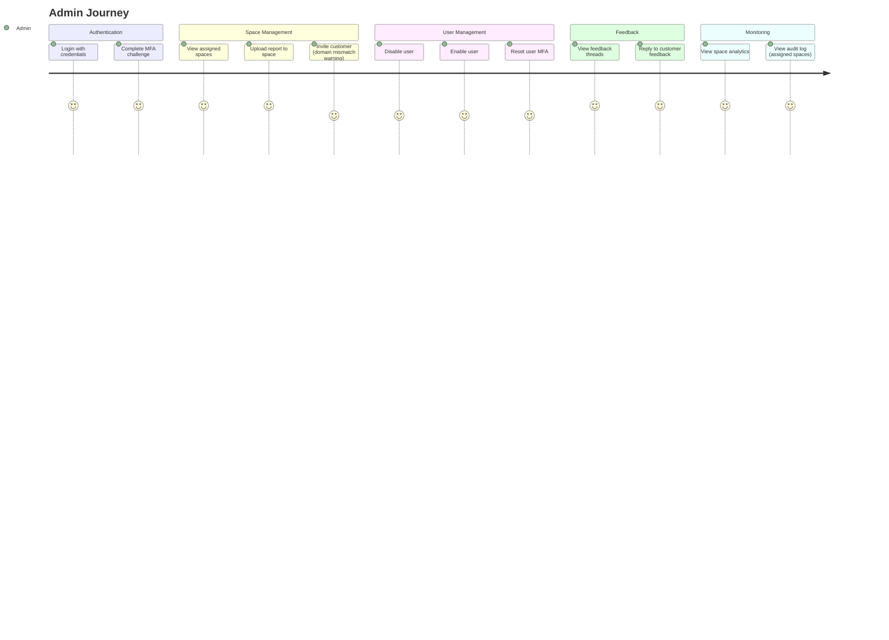
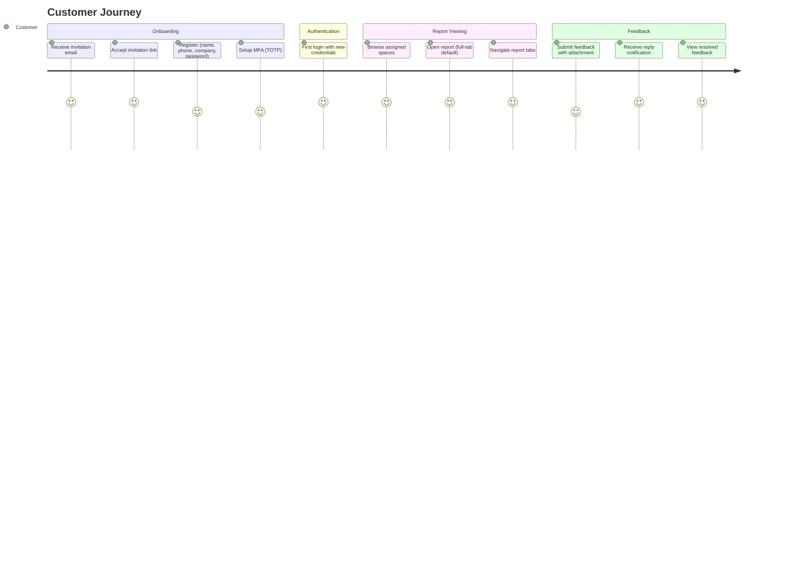
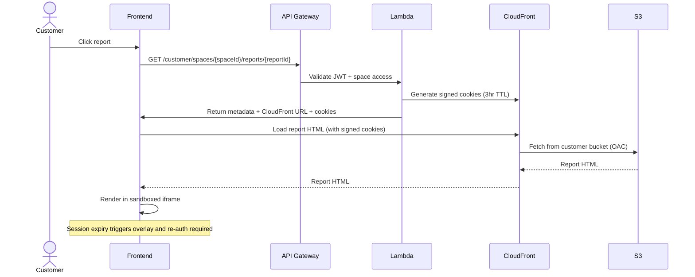
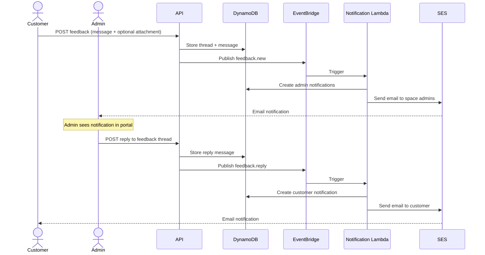
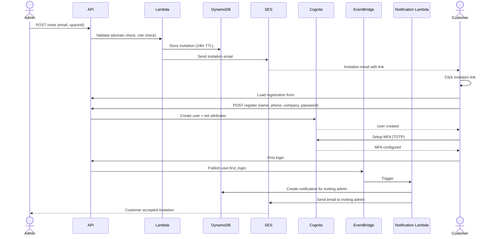
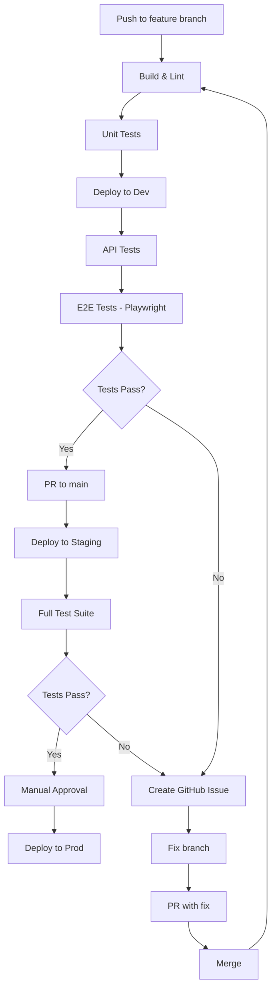

# Secure Report Portal

A security-first, multi-tenant AWS serverless application for delivering HTML reports to customers. Each customer has an isolated space with a dedicated S3 bucket. Reports are served via CloudFront with signed cookies, authenticated through API Gateway + Cognito.

## Architecture



## Tech Stack

| Layer | Technology |
|-------|-----------|
| Frontend | React 18, TypeScript, Vite, Tailwind CSS, shadcn/ui |
| Backend | Java 21, Spring Boot 3, Spring Cloud Function, Lambda SnapStart |
| Infrastructure | CDK v2 (TypeScript) |
| Auth | Cognito User Pool (MFA enforced) |
| Database | DynamoDB |
| Storage | S3 (per-customer bucket isolation) |
| CDN | CloudFront + WAF |
| Email | Amazon SES |
| Events | Amazon EventBridge |

## Project Structure

```
ReportsPortal/
├── infrastructure/          # CDK v2 TypeScript
│   ├── bin/                 # CDK app entry point
│   ├── lib/
│   │   ├── stacks/          # Auth, Storage, API, Events, Frontend, Security, Email, Monitoring
│   │   └── constructs/      # Reusable constructs (WAF, customer bucket, Lambda)
│   └── test/                # CDK assertion tests
├── backend/                 # Java 21 + Spring Boot 3
│   ├── shared/              # Shared library (models, security, services, DTOs)
│   ├── auth-function/       # Authentication Lambda
│   ├── admin-function/      # Admin operations Lambda
│   ├── customer-function/   # Customer operations Lambda
│   ├── feedback-function/   # Feedback system Lambda
│   ├── analytics-function/  # Analytics Lambda
│   ├── audit-function/      # Audit log Lambda
│   ├── notification-function/ # Notification delivery Lambda
│   └── cognito-triggers/    # Cognito pre-signup trigger
├── frontend/                # React SPA (admin + customer portal)
│   ├── src/
│   │   ├── components/      # UI, layout, auth, admin, customer, feedback components
│   │   ├── pages/           # Route pages (admin, customer, auth)
│   │   ├── hooks/           # Custom hooks
│   │   ├── contexts/        # Auth, notification contexts
│   │   ├── services/        # API service layer
│   │   └── types/           # TypeScript interfaces
│   └── public/
├── docker-compose.yml       # Local dev (DynamoDB Local)
└── CLAUDE.md                # Full project specification
```

## Prerequisites

- **Java 21** (with JAVA_HOME set)
- **Maven 3.9+** (or use included wrapper `./mvnw`)
- **Node.js 20+** and **npm 10+**
- **AWS CDK CLI** (`npm install -g aws-cdk`)
- **AWS SAM CLI** (for local Lambda testing)
- **Docker** (for DynamoDB Local)
- **AWS CLI v2** (configured with appropriate credentials)

## Local Development

### 1. Start Local Services

```bash
docker compose up -d
```

This starts:
- **DynamoDB Local** on port 8000
- **DynamoDB Admin UI** on port 8001 (http://localhost:8001)
- Automatically creates all required DynamoDB tables

### 2. Build Backend

```bash
cd backend
./mvnw clean package -DskipTests
```

### 3. Run Backend Locally (SAM CLI)

```bash
cd backend
sam local start-api --template template.yaml --port 3001 --warm-containers EAGER
```

### 4. Run Frontend

```bash
cd frontend
cp .env.example .env.development
# Edit .env.development with local config
npm install
npm run dev
```

Frontend runs on http://localhost:5173, proxying API calls to SAM on port 3001.

### 5. Run Tests

```bash
# Backend tests
cd backend && ./mvnw test

# Frontend tests
cd frontend && npm test

# CDK tests
cd infrastructure && npm test
```

## Deployment

### First-Time Setup

```bash
# Install CDK dependencies
cd infrastructure
npm install

# Bootstrap CDK (one-time per account/region)
cdk bootstrap aws://ACCOUNT_ID/ap-southeast-2

# Deploy all stacks
cdk deploy --all --context environment=dev
```

### Deploy to Specific Environment

```bash
# Development
cdk deploy --all --context environment=dev

# Staging
cdk deploy --all --context environment=staging

# Production
cdk deploy --all --context environment=prod
```

### Post-Deployment

After first deployment, the super admin account is seeded:
- **Email:** shanaka.jayasundera@versent.com.au
- **Temporary password:** Admin123!
- Must reset password and configure MFA on first login

## Security Highlights

- **AWS WAF** with managed rules (CRS, bot control, rate limiting, geo-restriction)
- **Per-customer S3 bucket isolation** with KMS encryption
- **CloudFront signed cookies** for report access (3-hour TTL)
- **Cognito MFA enforced** (TOTP preferred)
- **JWT tokens** with 15-min access / 1-hour refresh expiry
- **Content Security Policy** on report-serving CloudFront
- **iframe sandboxing** for HTML reports
- **HTML sanitization** on upload (OWASP Java HTML Sanitizer)
- **CORS** explicitly configured on API Gateway and CloudFront
- **Audit logging** on all operations (2-year retention)
- **Origin Access Control** on all S3 buckets

## Role Model

| Role | Access |
|------|--------|
| **Super Admin** | Full access, impersonation, admin invitations (@versent.com.au only) |
| **Admin** | Manage assigned spaces, invite customers, upload reports (@versent.com.au only) |
| **Customer** | View reports in assigned spaces, submit feedback |

## User Journeys

The following Mermaid diagrams illustrate the key user journeys and system flows within the Secure Report Portal.

---

### 1. Super Admin Journey

The Super Admin has full control over the platform, including creating customer spaces, inviting admins and customers, uploading reports, viewing analytics, and impersonating customers for support purposes.



---

### 2. Admin Journey

Admins manage their assigned customer spaces, upload reports, invite customers, handle feedback, and review analytics scoped to the spaces they are responsible for.



---

### 3. Customer Journey

Customers are invited by an Admin or Super Admin, complete registration with MFA setup, and can then browse their spaces, view reports, and submit feedback.



---

### 4. Report Viewing Flow

This sequence diagram shows the end-to-end flow when a customer opens a report, including JWT validation, CloudFront signed cookie generation, and sandboxed iframe rendering.



---

### 5. Feedback and Notification Flow

This sequence diagram shows how feedback is submitted, stored, and how notifications are delivered to admins and customers through EventBridge and SES.



---

### 6. Invitation Flow

This sequence diagram illustrates the complete customer invitation lifecycle, from the admin sending an invite through to the customer completing registration and MFA setup.



---

### 7. CI/CD Pipeline Flow

This flowchart shows the continuous integration and deployment pipeline, from code push through automated testing to production deployment with manual approval gates.



---

## Environment Variables

See `.env.example` files in `frontend/` and `backend/` directories for required configuration.
