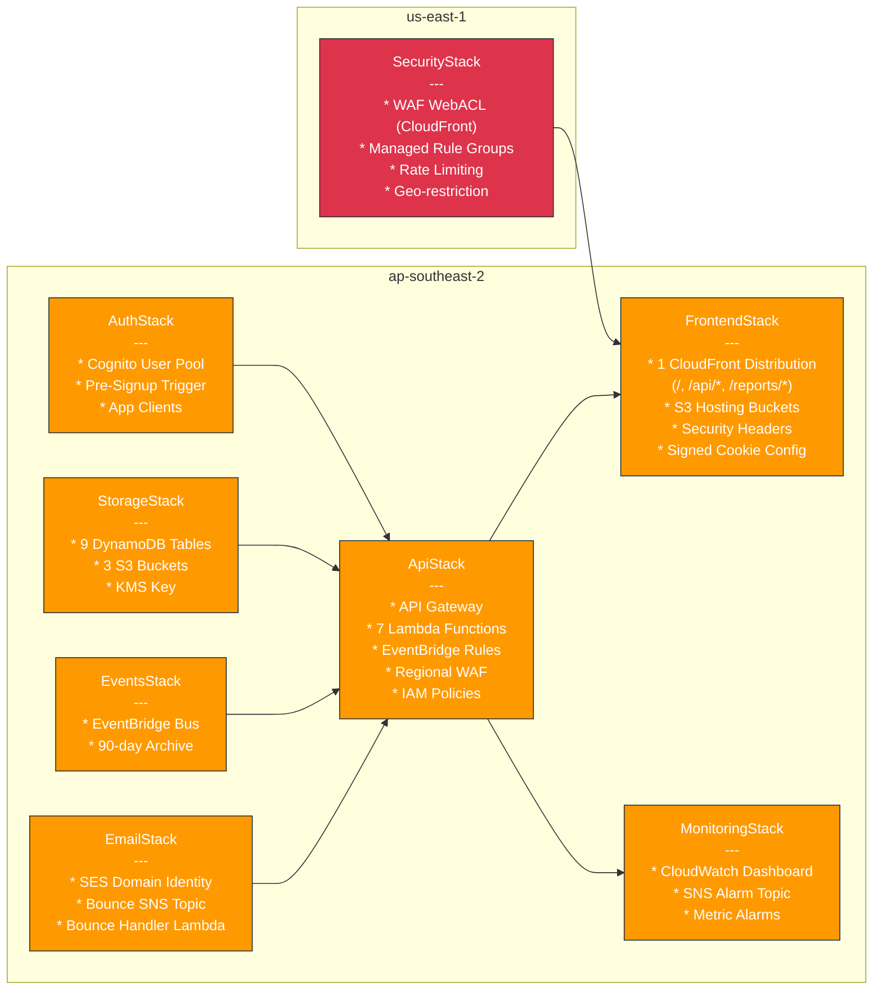
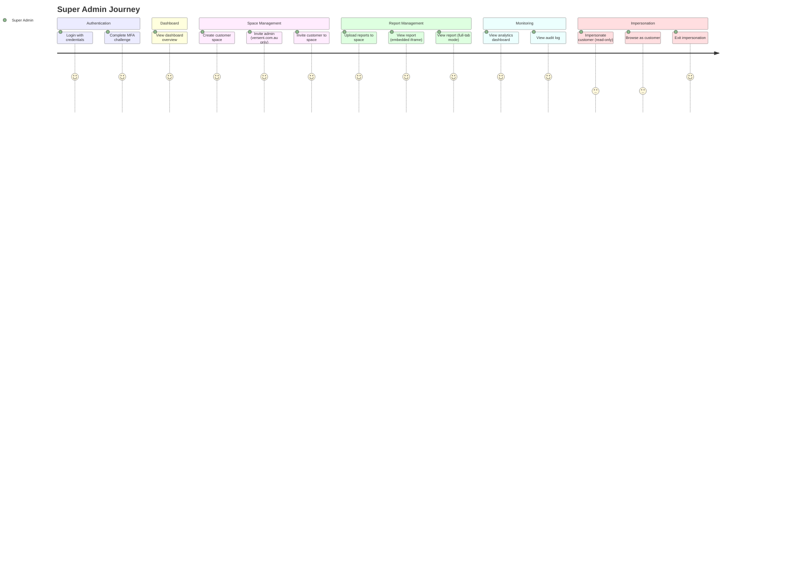
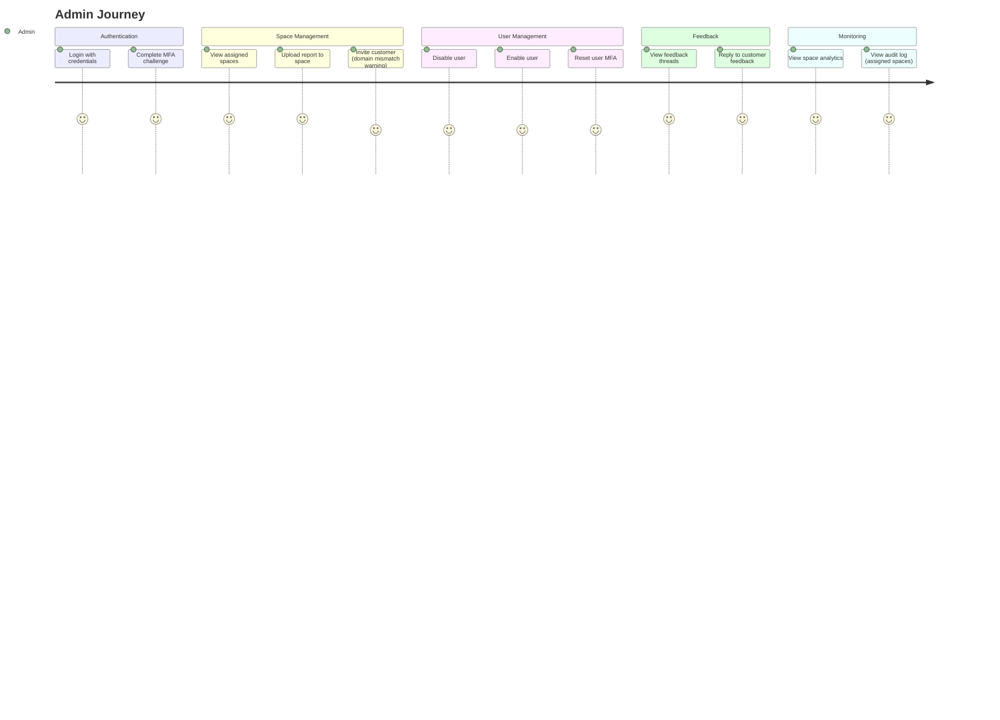
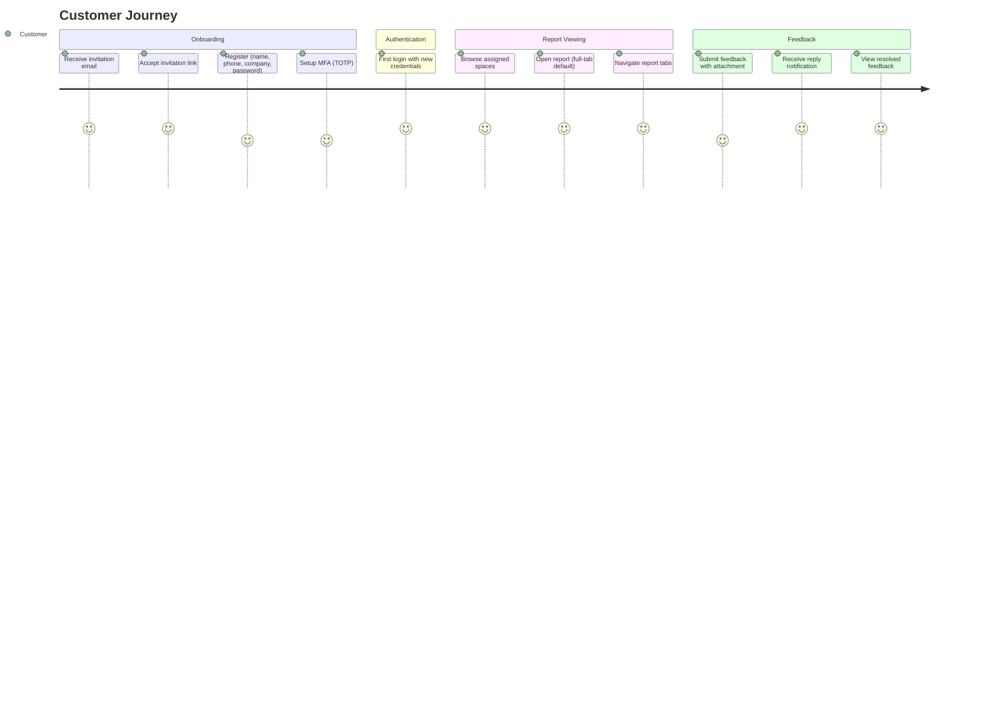
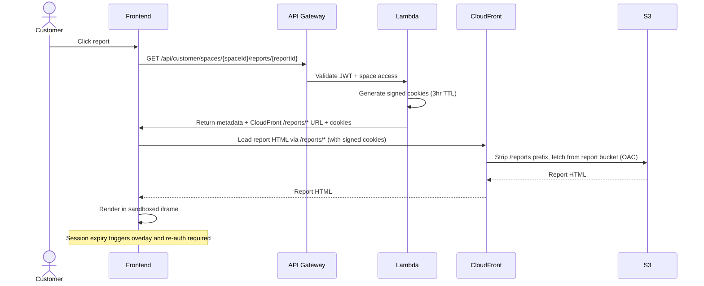
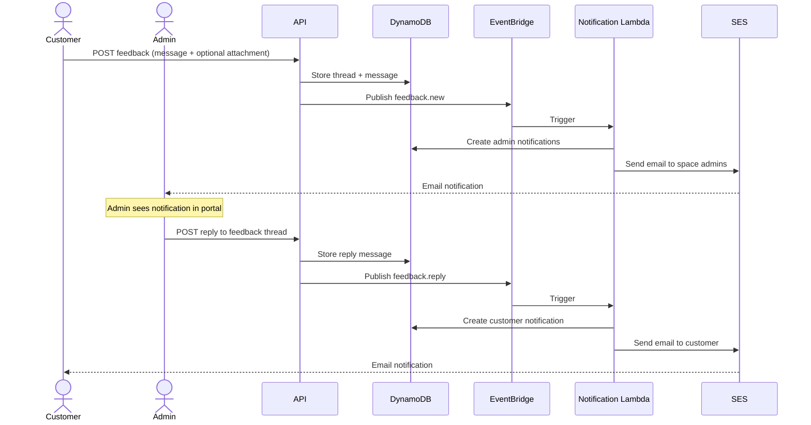
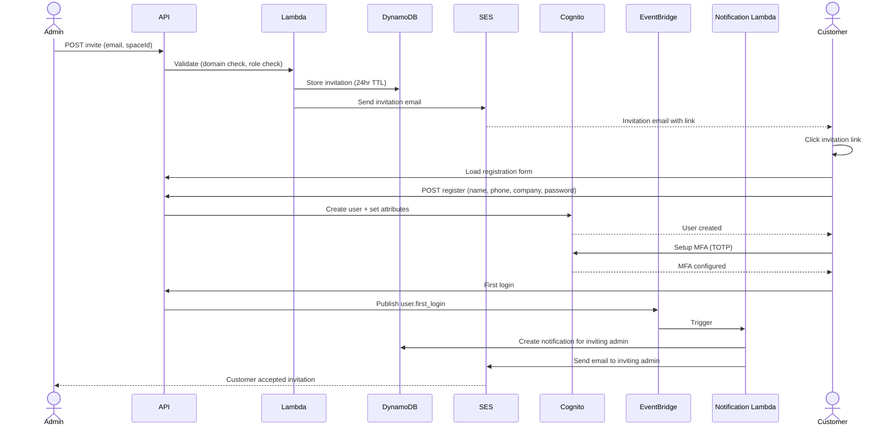

# Secure Report Portal

A security-first, multi-tenant AWS serverless application for delivering HTML reports to customers. Each customer has an isolated space with a dedicated S3 bucket. Reports are served via CloudFront with signed cookies, authenticated through API Gateway + Cognito.

## What It Does

Secure Report Portal enables consultancies and service providers to securely deliver HTML-based reports (assessments, audits, reviews) to their customers through a branded, self-service web portal.

### The Problem

Delivering sensitive reports to customers typically involves emailing attachments, sharing links to shared drives, or using generic file-sharing tools. These approaches lack access control, audit trails, and professional presentation.

### The Solution

Report Portal provides a dedicated, secure channel where:

- **Admins** (the service provider) create isolated customer spaces, upload HTML reports, and invite customers
- **Customers** log in with MFA, browse their reports in a clean portal, and provide feedback directly within the platform
- **Super Admins** manage the entire platform, invite other admins, and monitor usage via analytics and audit logs

### Key Business Capabilities

| Capability | Description |
|-----------|-------------|
| **Customer Spaces** | Each customer gets an isolated space with its own S3 bucket. No cross-customer data leakage is possible. |
| **Report Delivery** | Upload HTML reports (with embedded charts, tables, Mermaid diagrams) that customers view in a sandboxed iframe. |
| **Invitation-Only Access** | No self-registration. Admins invite customers by email; invitations expire after 24 hours. |
| **MFA-Enforced Login** | Every user must set up TOTP (authenticator app) on first login. No exceptions. |
| **Feedback System** | Customers can submit feedback on reports with file attachments. Admins receive email + in-app notifications. Threaded conversations with status tracking (open/in-progress/resolved). |
| **Audit Trail** | Every action (login, report view, upload, user change) is logged with 2-year retention. |
| **Analytics** | Track report views, active users, and engagement per space. Export analytics data for reporting. |
| **Impersonation** | Super admins can impersonate customers (read-only) for support and troubleshooting. |
| **Role-Based Access** | Three roles (Super Admin, Admin, Customer) with fine-grained permissions. Admins are scoped to their assigned spaces. |

### Typical Workflow

```
1. Super Admin creates a customer space (e.g., "acme-corp")
   --> Provisions isolated S3 bucket for report storage

2. Admin uploads HTML report to the space
   --> Report is sanitized, stored in S3, metadata saved to DynamoDB

3. Admin invites customer (e.g., john@acme.com) to the space
   --> Customer receives email with 24-hour invitation link

4. Customer accepts invitation
   --> Sets password, configures TOTP MFA via authenticator app

5. Customer logs in and views reports
   --> CloudFront signed cookies grant time-limited access to report files

6. Customer submits feedback on a report
   --> Admin receives email notification, replies in threaded conversation
```

## Architecture

### End-to-End System Architecture

The following diagram shows the complete serverless architecture across all AWS regions and layers, including every service, data flow, and security boundary.

```mermaid
flowchart TB
    subgraph Users["Users"]
        SA["Super Admin\n(@versent.com.au)"]
        AD["Admin\n(@versent.com.au)"]
        CU["Customer\n(Invited Only)"]
    end

    subgraph Edge["AWS Edge Layer (us-east-1 + ap-southeast-2)"]
        WAF["AWS WAF\n---\n* Core Rule Set (CRS)\n* Known Bad Inputs\n* Bot Control (COUNT)\n* Rate Limit: 1000/5min\n* Geo-block: AU only\n* IP Reputation List"]
        CF["CloudFront\nConsolidated Distribution\n---\n* / -> SPA (Portal)\n* /api/* -> API Gateway\n* /reports/* -> Report S3\n* Signed Cookies (3hr TTL)\n* HSTS, CSP, OAC\n* HTTP/2 + HTTP/3"]
    end

    subgraph Hosting["Frontend Hosting (ap-southeast-2)"]
        S3_SPA["S3 - SPA Bucket\n---\nReact 18 + TypeScript\nVite + Tailwind CSS\nshadcn/ui Components"]
    end

    subgraph Auth["Authentication Layer"]
        Cognito["Cognito User Pool\n---\n* MFA Required (TOTP)\n* Password: 12+ chars\n* Invitation-only signup\n* 15min access / 1hr refresh\n* Custom attrs: role, space"]
        PreSignup["Pre-Signup Trigger\n(Lambda)\n---\n* Validate invitation token\n* Check email domain\n* SnapStart enabled"]
    end

    subgraph API["API Layer"]
        APIGW["API Gateway (REST)\n---\n* Cognito Authorizer\n* CORS configured\n* Request validation\n* Regional WAF"]
    end

    subgraph Compute["Compute Layer - Java 21 + Spring Boot 3 (Lambda)"]
        AuthFn["Auth Function\n512MB / 30s\n---\n* POST /auth/login\n* POST /auth/mfa-verify\n* POST /auth/forgot-password\n* POST /auth/change-password\n* POST /auth/first-login"]
        AdminFn["Admin Function\n1536MB / 30s\n---\n* CRUD /admin/spaces\n* Upload /reports\n* POST /invite\n* POST /invite-admin\n* User mgmt (disable/enable/MFA)\n* POST /impersonate"]
        CustFn["Customer Function\n1024MB / 30s\n---\n* GET /customer/spaces\n* GET /reports (+ signed cookies)\n* PUT /preferences"]
        FeedFn["Feedback Function\n1024MB / 30s\n---\n* CRUD /feedback threads\n* POST /reply\n* PUT /status\n* POST /attachments\n* GET /admin/feedback/inbox"]
        AnalyticsFn["Analytics Function\n1024MB / 30s\n---\n* GET /admin/analytics/spaces\n* GET /admin/analytics/users\n* POST /admin/analytics/export"]
        AuditFn["Audit Function\n1024MB / 30s\n---\n* GET /admin/audit-log\n* Paginated queries"]
        NotifFn["Notification Function\n1024MB / 30s\n---\n* GET /notifications\n* PUT /read, /read-all\n* GET /count\n* EventBridge target (5 events)"]
    end

    subgraph Storage["Data Layer (ap-southeast-2)"]
        subgraph DDB["DynamoDB (PAY_PER_REQUEST + KMS)"]
            T1["Users Table\nPK: USER#id | SK: PROFILE\nGSI: email-index"]
            T2["Spaces Table\nPK: SPACE#id | SK: META\nGSI: spaceName-index"]
            T3["Reports Table\nPK: SPACE#id | SK: REPORT#id"]
            T4["Invitations Table\nPK: INVITE#token | SK: META\n24hr TTL"]
            T5["AuditLog Table\nPK: AUDIT#date | SK: EVENT#ts\n2-year retention"]
            T6["Analytics Table\nPK: ANALYTICS#space | SK: EVENT#ts\nGSI: report-analytics-index"]
            T7["Notifications Table\nPK: NOTIFICATION#user | SK: ts#id\nGSI: unread-index"]
            T8["FeedbackThreads Table\nPK: THREAD#id | SK: META\n3 GSIs: report, space, status"]
            T9["FeedbackMessages Table\nPK: THREAD#id | SK: MESSAGE#id"]
        end
        subgraph S3["S3 Buckets (KMS Encrypted)"]
            S3_Cust["Customer Report Buckets\n---\n* Per-customer isolation\n* Versioning enabled\n* Glacier archive (2yr)\n* Server access logging\n* Block public access"]
            S3_Feedback["Feedback Attachments\nBucket"]
            S3_Audit["Audit Log Archive\nBucket"]
        end
        KMS["KMS\nCustomer-Managed Key\nAnnual Rotation"]
    end

    subgraph Events["Event-Driven Layer"]
        EB["EventBridge\nCustom Event Bus\n---\n* 90-day archive\n* 5 event rules\n* 3 retries / 1hr max"]
        subgraph EventTypes["Event Types"]
            E1["feedback.new"]
            E2["feedback.reply"]
            E3["user.first_login"]
            E4["feedback.resolved"]
            E5["invitation.accepted"]
        end
        SES["Amazon SES\n---\n* Domain identity\n* Bounce/complaint SNS\n* Bounce handler Lambda"]
    end

    subgraph Monitoring["Observability Layer"]
        CW["CloudWatch\n---\n* Structured JSON logs\n* Custom dashboard\n* API latency: p50/p95/p99\n* Lambda duration & errors\n* DDB consumed capacity"]
        Alarms["CloudWatch Alarms\n---\n* Lambda error rate\n* API 4xx/5xx rates\n* DDB throttling\n* SNS alert topic"]
        XRay["X-Ray\nDistributed Tracing"]
    end

    %% User flows
    SA & AD & CU --> WAF
    WAF --> CF
    CF --> S3_SPA
    CF -->|"OAC"| S3_Cust
    CF --> APIGW

    %% Auth flows
    APIGW <-->|"JWT validation"| Cognito
    Cognito --> PreSignup

    %% API to Lambda routing
    APIGW --> AuthFn
    APIGW --> AdminFn
    APIGW --> CustFn
    APIGW --> FeedFn
    APIGW --> AnalyticsFn
    APIGW --> AuditFn

    %% Lambda to data
    AuthFn --> T1 & T4 & T5
    AuthFn <--> Cognito
    AdminFn --> T1 & T2 & T3 & T4 & T5
    AdminFn --> S3_Cust
    AdminFn --> EB
    CustFn --> T1 & T2 & T3
    CustFn -->|"Generate signed cookies"| CF
    FeedFn --> T8 & T9 & T5
    FeedFn --> S3_Feedback
    FeedFn --> EB
    AnalyticsFn --> T6
    AuditFn --> T5
    NotifFn --> T7
    NotifFn --> SES

    %% Event flows
    EB --> E1 & E2 & E3 & E4 & E5
    E1 & E2 & E3 & E4 & E5 --> NotifFn

    %% KMS encryption
    KMS -.->|"Encrypts"| S3_Cust & S3_Feedback & S3_Audit & DDB

    %% Monitoring
    AuthFn & AdminFn & CustFn & FeedFn & AnalyticsFn & AuditFn & NotifFn --> CW
    AuthFn & AdminFn & CustFn & FeedFn --> XRay
    CW --> Alarms

    %% Styles
    classDef edge fill:#ff9900,stroke:#232f3e,color:#fff
    classDef compute fill:#ed7100,stroke:#232f3e,color:#fff
    classDef storage fill:#3b48cc,stroke:#232f3e,color:#fff
    classDef event fill:#e7157b,stroke:#232f3e,color:#fff
    classDef monitor fill:#2ea44f,stroke:#232f3e,color:#fff
    classDef auth fill:#dd344c,stroke:#232f3e,color:#fff
    classDef kms fill:#8c4fff,stroke:#232f3e,color:#fff

    class WAF,CF edge
    class AuthFn,AdminFn,CustFn,FeedFn,AnalyticsFn,AuditFn,NotifFn,PreSignup compute
    class T1,T2,T3,T4,T5,T6,T7,T8,T9,S3_Cust,S3_Feedback,S3_Audit,S3_SPA storage
    class EB,SES,E1,E2,E3,E4,E5 event
    class CW,Alarms,XRay monitor
    class Cognito,APIGW auth
    class KMS kms
```



### CDK Stack Dependency Graph

This diagram shows the 8 CDK stacks and their deployment dependencies.



## Tech Stack

| Layer | Technology |
|-------|-----------|
| Frontend | React 18, TypeScript, Vite, Tailwind CSS, shadcn/ui |
| Backend | Java 21, Spring Boot 3, Spring Cloud Function, Lambda SnapStart |
| Infrastructure | CDK v2 (TypeScript), 8 stacks |
| Auth | Cognito User Pool (MFA enforced, TOTP) |
| Database | DynamoDB (9 tables, KMS encrypted) |
| Storage | S3 (per-customer bucket isolation, KMS) |
| CDN | CloudFront (consolidated distribution) + WAF |
| Email | Amazon SES |
| Events | Amazon EventBridge |
| CI/CD | GitHub Actions (OIDC auth) |

## Project Structure

```
ReportsPortal/
├── .github/
│   └── workflows/
│       ├── ci.yml              # CI: lint, test, build on PR/push to main
│       └── deploy.yml          # CD: manual deploy to dev/staging/prod
├── infrastructure/             # CDK v2 TypeScript
│   ├── bin/                    # CDK app entry point + environment configs
│   ├── lib/
│   │   ├── stacks/             # Auth, Storage, API, Events, Frontend, Security, Email, Monitoring
│   │   └── constructs/         # Reusable constructs (WAF, customer bucket, Lambda)
│   └── test/                   # CDK assertion tests
├── backend/                    # Java 21 + Spring Boot 3
│   ├── shared/                 # Shared library (models, security, services, DTOs)
│   ├── auth-function/          # Authentication Lambda
│   ├── admin-function/         # Admin operations Lambda
│   ├── customer-function/      # Customer operations Lambda
│   ├── feedback-function/      # Feedback system Lambda
│   ├── analytics-function/     # Analytics Lambda
│   ├── audit-function/         # Audit log Lambda
│   ├── notification-function/  # Notification delivery Lambda
│   └── cognito-triggers/       # Cognito pre-signup trigger
├── frontend/                   # React SPA (admin + customer portal)
│   ├── src/
│   │   ├── components/         # UI, layout, auth, admin, customer, feedback components
│   │   ├── pages/              # Route pages (admin, customer, auth)
│   │   ├── hooks/              # Custom hooks (useAuth, useNotifications)
│   │   ├── contexts/           # Auth, notification contexts
│   │   ├── services/           # API service layer (auth, spaces, reports, users)
│   │   └── types/              # TypeScript interfaces
│   └── public/
├── e2e/                        # Playwright E2E tests
├── docker-compose.yml          # Local dev (DynamoDB Local)
└── CLAUDE.md                   # Full project specification
```

## Prerequisites

- **Java 21** (with JAVA_HOME set)
- **Maven 3.9+** (or use included wrapper `./mvnw`)
- **Node.js 20+** and **npm 10+**
- **AWS CDK CLI** (`npm install -g aws-cdk`)
- **AWS SAM CLI** (for local Lambda testing)
- **Docker** (for DynamoDB Local)
- **AWS CLI v2** (configured with appropriate credentials)

## Local Development

### 1. Start Local Services

```bash
docker compose up -d
```

This starts:
- **DynamoDB Local** on port 8000
- **DynamoDB Admin UI** on port 8001 (http://localhost:8001)
- Automatically creates all required DynamoDB tables

### 2. Build Backend

```bash
cd backend
./mvnw clean package -DskipTests
```

### 3. Run Backend Locally (SAM CLI)

```bash
cd backend
sam local start-api --template template.yaml --port 3001 --warm-containers EAGER
```

### 4. Run Frontend

```bash
cd frontend
cp .env.example .env.development
# Edit .env.development with local config
npm install
npm run dev
```

Frontend runs on http://localhost:5173, proxying API calls to SAM on port 3001.

### 5. Run Tests

```bash
# Backend tests
cd backend && ./mvnw test

# Frontend tests
cd frontend && npm test

# CDK tests
cd infrastructure && npm test

# E2E tests (requires deployed environment)
cd e2e && npx playwright test
```

## Deployment

### First-Time Setup

```bash
# Install CDK dependencies
cd infrastructure
npm install

# Bootstrap CDK (both regions required)
cdk bootstrap aws://ACCOUNT_ID/ap-southeast-2
cdk bootstrap aws://ACCOUNT_ID/us-east-1   # Required for CloudFront WAF

# Build backend JARs
cd ../backend
./mvnw clean package -DskipTests

# Deploy all stacks
cd ../infrastructure
cdk deploy --all --context environment=dev
```

### Deploy to Specific Environment

```bash
# Development
cdk deploy --all --context environment=dev

# Staging
cdk deploy --all --context environment=staging

# Production (uses RemovalPolicy.RETAIN for Cognito + DynamoDB)
cdk deploy --all --context environment=prod
```

### Frontend-Only Deploy

After infrastructure is deployed, you can update just the SPA without redeploying CDK stacks:

```bash
cd frontend
npm run build

# Sync to S3 and invalidate CloudFront
aws s3 sync dist/ s3://BUCKET_NAME/ --delete
aws cloudfront create-invalidation --distribution-id DIST_ID --paths "/*"
```

### CI/CD Pipelines (GitHub Actions)

The project includes two GitHub Actions workflows:

**CI Pipeline** (`.github/workflows/ci.yml`) - Runs automatically on PRs and pushes to `main`:
- Frontend: lint, test, build
- Backend: Maven build and test
- Infrastructure: CDK compile and Jest tests

**CD Pipeline** (`.github/workflows/deploy.yml`) - Manual trigger via `workflow_dispatch`:
- Select target environment: `dev`, `staging`, or `prod`
- Option to skip infrastructure and deploy frontend only (`skip_infra`)
- Uses OIDC for AWS authentication (no long-lived credentials)
- Builds backend JARs and frontend bundle in parallel
- Deploys CDK stacks, syncs SPA to S3, invalidates CloudFront

To use the CD pipeline, configure these GitHub environment variables:
- `AWS_DEPLOY_ROLE_ARN` - IAM role ARN for OIDC-based deployment
- `SPA_BUCKET_NAME` - S3 bucket name (for frontend-only deploys)
- `CLOUDFRONT_DISTRIBUTION_ID` - Distribution ID (for frontend-only deploys)

### Post-Deployment

After first deployment, the super admin account is automatically seeded:
- **Email:** (configured in `cdk.json` as `superAdminEmail`)
- **Temporary password:** Output in CloudFormation (check Secrets Manager or Lambda logs)
- Must reset password and configure MFA (TOTP) on first login

### Data Retention on Stack Updates

| Resource | dev / staging | prod |
|----------|--------------|------|
| Cognito User Pool | `DESTROY` | `RETAIN` |
| DynamoDB Tables | `DESTROY` | `RETAIN` |
| S3 Buckets | `DESTROY` | `RETAIN` |

In production, Cognito users (passwords, MFA), DynamoDB data, and S3 objects are preserved even if the stack is deleted or recreated.

## Security Highlights

- **Dual WAF protection** - CloudFront WAF (us-east-1) + API Gateway regional WAF (ap-southeast-2)
- **WAF managed rules** - Core Rule Set, Known Bad Inputs, Bot Control (COUNT mode), IP Reputation, rate limiting, geo-restriction (AU only)
- **Origin verification** - API Gateway WAF validates CloudFront origin header to prevent direct access
- **Per-customer S3 bucket isolation** with KMS encryption
- **CloudFront signed cookies** for report access (3-hour TTL)
- **Cognito MFA enforced** (TOTP via authenticator app)
- **JWT tokens** with 15-min access / 1-hour refresh expiry
- **Single CloudFront distribution** with path-based routing (`/`, `/api/*`, `/reports/*`)
- **Content Security Policy** on both SPA and report-serving paths
- **iframe sandboxing** for HTML reports
- **HTML sanitization** on upload (OWASP Java HTML Sanitizer)
- **CORS** explicitly configured on API Gateway and CloudFront
- **Audit logging** on all operations (2-year retention)
- **Origin Access Control (OAC)** on all S3 buckets

## Authentication Flow

```
Login -> Cognito SRP Auth
  |
  ├── NEW_PASSWORD_REQUIRED -> First Login Page -> Set new password
  |     └── MFA_SETUP -> MFA Setup Page -> Scan QR code -> Verify TOTP
  |
  ├── SOFTWARE_TOKEN_MFA -> MFA Verify Page -> Enter TOTP code
  |
  └── Success -> Dashboard (Admin or Customer based on role)
```

Key auth features:
- **First login:** User is prompted to change temporary password, then immediately set up TOTP MFA
- **MFA setup:** QR code generated locally using `qrcode.react` (no external API dependencies)
- **Token refresh:** Automatic silent refresh on 401 responses via axios interceptor
- **Invitation-only:** No self-registration; customers are invited by admins to specific spaces

## Role Model

| Role | Access |
|------|--------|
| **Super Admin** | Full access, impersonation, admin invitations, space CRUD (@versent.com.au only) |
| **Admin** | Manage assigned spaces, invite customers, upload reports, user management (@versent.com.au only) |
| **Customer** | View reports in assigned spaces, submit feedback (invited only) |

## User Journeys

### 1. Super Admin Journey



### 2. Admin Journey



### 3. Customer Journey



### 4. Report Viewing Flow



### 5. Feedback and Notification Flow



### 6. Invitation Flow



## Environment Variables

### Frontend (`frontend/.env.example`)

```
VITE_API_BASE_URL=http://localhost:3001
VITE_COGNITO_USER_POOL_ID=ap-southeast-2_XXXXXXXXX
VITE_COGNITO_CLIENT_ID=xxxxxxxxxxxxxxxxxxxxxxxxxx
VITE_COGNITO_REGION=ap-southeast-2
VITE_CLOUDFRONT_DOMAIN=https://portal.yourdomain.com
```

### Backend (`backend/.env.example`)

```
DYNAMODB_ENDPOINT=http://localhost:8000
COGNITO_USER_POOL_ID=ap-southeast-2_XXXXXXXXX
COGNITO_CLIENT_ID=xxxxxxxxxxxxxxxxxxxxxxxxxx
AWS_REGION=ap-southeast-2
SES_SENDER_EMAIL=noreply@reports.yourdomain.com
EVENTBRIDGE_BUS_NAME=report-portal-events
CLOUDFRONT_KEY_PAIR_ID=XXXXXXXXXXXXXXXXXX
CLOUDFRONT_PRIVATE_KEY_SECRET_ARN=arn:aws:secretsmanager:...
CLOUDFRONT_DOMAIN=https://portal.yourdomain.com
FEEDBACK_BUCKET_NAME=report-portal-feedback-...
```

## CDK Environment Configuration

Environments are configured in `infrastructure/cdk.json` under the `environments` context key. Each environment specifies:

```json
{
  "account": "123456789012",
  "region": "ap-southeast-2",
  "domainName": "portal.yourdomain.com",
  "adminDomainName": "admin.yourdomain.com",
  "sesDomain": "reports.yourdomain.com",
  "allowedGeoLocations": ["AU"],
  "wafRateLimit": 1000,
  "signedCookieTtlHours": 3,
  "invitationExpiryHours": 24,
  "superAdminEmail": "admin@yourdomain.com",
  "logRetentionDays": 30
}
```
